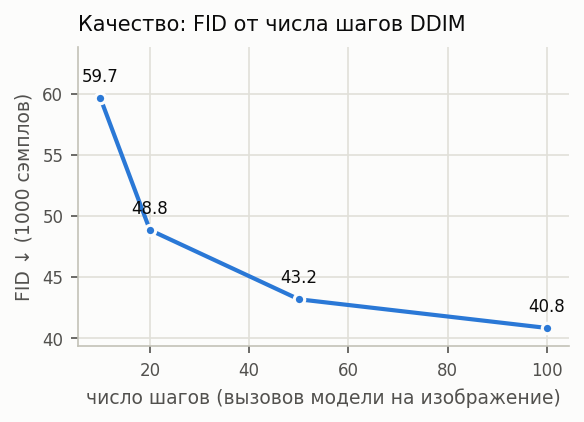
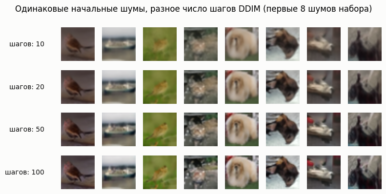

# Отчёт по этапу 1

Проект: Разные методы генерации из диффузионных моделей

Автор: Коновалов Валентин Русланович

## 1. Постановка задачи

Диффузионная модель генерирует изображение, решая обыкновенное дифференциальное уравнение, связывающее чистый шум и чистое изображение. Число шагов численного решения — главный множитель стоимости инференса, и разные сэмплеры по-разному конвертируют количество вызовов модели в качество. Цель проекта — исследовать этот компромисс на трёх сэмплерах: DDIM, DPM-Solver++ (2M) и Heun по схеме EDM, а затем научиться подбирать расписание уровней шума под заданный бюджет.

## 2. Ресурсы и ограничения

Железо: MacBook Pro с Apple M2 Pro и 16 ГБ объединённой памяти (ускоритель MPS). При необходимости доступен Google Colab с NVIDIA T4 (16 ГБ).

Диффузионная модель не обучается — используются готовые веса, а обучается/подбирается только расписание шагов сэмплирования. Поэтому необходимости в мощных видеокартах для обучения нет.

## 3. Разбор методов

Диффузионная модель учится обращать постепенное зашумление изображения. Прямой процесс задан расписанием: зашумлённая картинка на каждом уровне шума — линейная смесь чистого изображения и гауссовского шума с известными коэффициентами:

  x_t = α_t·x₀ + σ_t·ε,   α_t = √ᾱ_t,   σ_t = √(1 − ᾱ_t),

где ᾱ_t — расписание из чекпойнта, ε ~ N(0, I). Из-за этой линейности одно и то же предсказание сети можно выразить по-разному: предсказанный шум, восстановленное чистое изображение, скорость процесса или «очищенная» версия текущей картинки (денойзер EDM). Эти представления эквивалентны и пересчитываются друг в друга, например восстановленное изображение через прогноз шума:

  x̂₀ = (x_t − σ_t·ε̂)/α_t.

Пересчитываются они без новых вызовов модели, но DDIM работает с шумом, DPM-Solver++ — с восстановленным изображением, Heun — с денойзером. Выбор параметризации не меняет модель, но определяет форму шага и его устойчивость: ветка восстановленного изображения гладко меняется по времени, и именно на этой гладкости строятся методы второго порядка.

При детерминированном сэмплировании генерация — решение одного обыкновенного дифференциального уравнения: оно ведёт от чистого шума к чистому изображению, а сеть в каждый момент указывает направление движения:

  dx/dt = (α̇_t/α_t)·x + (σ̇_t − σ_t·(α̇_t/α_t))·ε̂(x_t, t).

Слагаемое с x линейно и решается точно, нелинейна только часть с ε̂ — различия между сэмплерами сводятся к тому, как её аппроксимировать:

- DDIM — простейшая схема первого порядка: направление вычисляется один раз в начале шага и далее считается постоянным. Один вызов модели на шаг. Эквивалентен DPM-Solver++(1S).
- DPM-Solver++ (2M) — метод второго порядка: направление уточняется по двум последним оценкам модели, так что кривизна траектории учитывается без роста цены — по-прежнему один вызов на шаг, вторая оценка переиспользуется из прошлого шага. Плата за это — хранение истории и особый первый шаг.
- Heun/EDM — классическая схема «предиктор–корректор»: шаг делается вперёд по грубому направлению, направление пересчитывается в новой точке, и шаг усредняется из двух оценок. Два вызова модели на шаг (последний — один). Шаги идут по Karras-сетке, сгущённой к концам интервала.

Одна и та же ε-модель обслуживает любое из представлений: переменные VP-процесса и EDM-шкалы связаны точной заменой переменных

  σ = σ_t/α_t,   x̃ = x_t/α_t,

и в этих переменных уравнение принимает вид

  dx̃/dσ = (x̃ − D(x̃, σ))/σ,   D(x̃, σ) = x̃ − σ·ε̂,

поэтому денойзер для Heun строится прямо из прогноза шума, а обратный переход сводится к поиску ближайшего уровня шума на дискретной сетке модели. Это и есть «обвязка», которую нужно реализовать и проверить.

Что реализовано на этапе 1:

- класс `EpsilonNet` — единый интерфейс к UNet: прогноз шума ε(x, t), восстановление x̂₀, EDM-денойзер D(x, σ) и обратный поиск уровня шума t(σ)
- генерация с ручным циклом, подсчётом числа шагов и замером времени (`torch.mps.synchronize()`).

Корректность обвязки проверена качественно: реальные изображения CIFAR-10 test зашумляются на нескольких уровнях шума, и обвязка восстанавливает через них x̂₀ — с ростом уровня шума детали закономерно теряются, а VP-путь и EDM-денойзер дают одну и ту же картинку. Численная сверка собственных реализаций сэмплеров с Diffusers — первый шаг этапа 2.

## 4. Данные и модели

Генеративная модель — `google/ddpm-cifar10-32` из HuggingFace Diffusers, UNet2DModel, обученный авторами DDPM на CIFAR-10 (ε-параметризация, T = 1000, линейное расписание β от 1e-4 до 0.02). Выбор обусловлен тем, что это опорная модель статьи DDPM, она мала (35.7M параметров, быстрая на MPS), полностью детерминированно сэмплируется и поддерживается Diffusers — эталоном для проверки реализаций. Веса — открытые (apache-2.0 у Diffusers-модели).

Референс для FID — тестовая часть CIFAR-10, 10 000 изображений, сохранённых в PNG (`data/cifar10_test/`). Источник — публичное зеркало `uoft-cs/cifar10` на HuggingFace (parquet). Лицензия CIFAR-10 допускает использование в исследовательских целях. Обучающая часть не используется: модель уже обучена, разбивка train/test здесь превращается в генерация (наш пайплайн) vs референс (test).

Фиксированный набор шумов — 1000 векторов x_T ~ N(0, I) размером 3×32×32, сгенерированных CPU-генератором с seed 2026 (`data/fixed_noise.pt`). CPU-генератор делает набор воспроизводимым независимо от устройства. Все генерации этапа 1 и все запланированные сравнения этапа 2 идут на одном и том же шуме — это устраняет дисперсию сравнения: разница между конфигурациями не может быть объяснена удачей конкретного шума.

FID-калькулятор — `pytorch_fid`: InceptionV3 (пул 2048), веса `pt_inception-2015-12-05`. Референсные статистики (μ, Σ) посчитаны один раз по 10k тестовых изображений и сохранены в `data/fid_stats_cifar10_test.npz`.

Все нейросети в проекте (UNet, InceptionV3) взяты готовыми, обучается/подбирается только расписание шагов сэмплирования.

## 5. Метрики и протокол оценки

Протокол фиксируется до основных экспериментов — чтобы сравнение baseline и всех конфигураций этапа 2 шло по одним правилам. Метрики:

- FID (Fréchet Inception Distance) — расстояние между распределениями наборов изображений. Оба набора прогоняются через InceptionV3, для каждого изображения берётся 2048-мерный эмбеддинг слоя пула, и для каждого набора считаются среднее μ и ковариация Σ. Затем
  FID = ‖μ_r − μ_g‖² + Tr(Σ_r + Σ_g − 2·(Σ_r·Σ_g)^{1/2}).
  Меньше — лучше, 0 — совпадающие статистики. У нас 1000 генераций против заранее посчитанных статистик 10k CIFAR-10 test. FID чувствителен к объёму выборки (оценка ковариации на 1000 точках зашумлена - систематическое завышение), поэтому сравниваются только конфигурации с одинаковым числом изображений, а для финальных лучших — контрольный прогон на 10k.
- MSE / PSNR к референсу — парная метрика, в отличие от FID сравнивает не распределения, а каждую картинку с её референсом. Так как сэмплирование детерминировано, генерация с N_ref = 100 шагами на том же шуме — естественная «истина» (предел ODE). MSE — средний квадрат разности пикселей, генерации приводятся к диапазону [0, 1] (сохранение в uint8 и деление на 255). PSNR = 10·log₁₀(MAX²/MSE) — та же величина в децибелах, MAX — максимально возможное значение пикселя, в нашей шкале 1.
- Число шагов — вызовы модели на изображение, считаются программно (счётчик в обвязке), для Heun один шаг включает два вызова (предиктор и корректор).
- Время — wall-clock генерации 1000 изображений с синхронизацией MPS, фиксированный батч 250, один и тот же процесс без «холодного старта» (первый батч — прогрев, в замер не идёт). Время подбора расписания замеряется отдельно и не смешивается с временем инференса.
- Визуальная оценка

Сопоставимость условий: единый шум (1000 фиксированных векторов, seed 2026), единый референс FID, единая конфигурация модели (fp32, без τ-экспоненты и проч. трюков), единый код обвязки. Повторные прогоны не усредняются — сэмплирование детерминировано, разброс возможен только от недетерминизма железа и в FID-статистиках генераций (последние зависят только от детерминированных тензоров — поэтому их и нет).

## 6. Воспроизведение baseline

Точка отсчёта — DDIM из Diffusers (`DDIMScheduler`, 50 шагов, leading spacing, η = 0), т.е. ровно то, что получил бы пользователь библиотеки «из коробки». На фиксированном шуме сгенерировано 1000 изображений (батчи по 250, fp32, MPS):

| Метрика | Значение |
|---|---|
| Число шагов на изображение | 50 |
| Время генерации 1000 изображений | 235 с |
| FID (1000 генераций vs 10k CIFAR-10 test) | 43.17 |

Попутно проверена корректность замера: FID(тест, тест) = 0.0000.

Важно отметить, что FID чувствителен к объёму выборки, и на 1000 изображениях он систематически завышен (публикуемые FID для этой модели — порядка 3–5 на 10k–50k сэмплов). Поэтому абсолютное число 43 не интерпретируется как качество модели — все выводы делаются по относительным различиям между конфигурациями, посчитанными на одинаковом числе изображений с одним и тем же референсом.

Первичная проверка зависимости качества от числа шагов (DDIM, тот же шум, тот же конвейер):

| Число шагов | FID | Время, с | MSE к референсу 100 шагов | PSNR, дБ |
|---|---|---|---|---|
| 10 | 59.65 | 53 | 3.38e-3 | 24.7 |
| 20 | 48.84 | 104 | 1.46e-3 | 28.4 |
| 50 | 43.17 | 235 | 4.48e-4 | 33.5 |
| 100 | 40.82 | 490 | 0 (референс) | — |

Наблюдения:
- время линейно по числу шагов — на MPS каждый вызов модели стоит одинаково
- качество растёт с числом шагов, но с убывающей отдачей (−10.8 FID при переходе 10→20 против −2.3 при 50→100)
- MSE к 100-шаговому референсу убывает на порядок при каждом удвоении — детерминированная сэмплировка сходится к пределу ODE. Цель этапа 2: достичь качества DDIM-100 за меньшее число вызовов за счёт сэмплера и расписания.

Рис. 1. Качество (FID, 1000 генераций) в зависимости от числа шагов DDIM.

Рис. 2. Первые 8 шумов картинок, сгенерированные DDIM при разном числе шагов. Сюжеты стабильны между строками — меняется только детализация, что и ожидалось.

## 7. План этапа 2

Планируемые шаги:

1. Валидация реализаций DPM-Solver++(2M) и Heun/EDM против Diffusers — совпадение траекторий до машинной точности.
2. Сравнение сэмплеров при равном числе шагов на сетке {5, 10, 15, 20, 30, 50}: FID, время, MSE к общему референсу (детерминированная генерация с большим числом шагов). У Heun шаг стоит двух вызовов — при равном бюджете он делает вдвое меньше шагов.
3. Сравнение расписаний (leading / linspace / trailing / Karras) на каждом сэмплере и диагностика участков, требующих шагов, — по вкладу локальной ошибки с визуализацией по σ.
4. Алгоритм подбора уровней шума: Nelder–Mead по внутренним узлам log-σ, целевая функция — средняя MSE до N_ref-шаговой генерации на 128 шумах, бюджет порядка 500 оценок, считается отдельно от времени инференса.
5. Переносимость: новые шумы (оставшиеся 872 и свежий seed) и кросс-сэмплер, метрика — деградация относительно расписания, подобранного под конкретный сэмплер.
6. Финальная сводка: лучшие конфигурации на 10k, таблица «метод × число шагов × расписание → FID / время», визуальные примеры улучшений и ухудшений, отчёт и демо.

Оси сравнения методов: качество (FID, MSE к референсу, визуально) против стоимости (число шагов, время). Память потребляется одинаково всеми методами (одна модель и один батч у всех).

Критерии успеха этапа 2: FID уровня DDIM-50 при числе шагов ≤ 25 хотя бы на одном сэмплере, подтверждённый или опровергнутый вывод о переносимости расписаний, воспроизводимость всех чисел по протоколу.

Дополнительная часть: PixArt-α 256×256 на подвыборке COCO — предвычислить текстовые эмбеддинги, выгрузить текстовый энкодер из памяти, проверить расписания и алгоритм подбора на текстовом пайплайне. Выполняется строго после обязательных экспериментов на CIFAR-10.

Ожидаемые результаты: Сэмплеры второго порядка должны обойти DDIM при малом числе шагов. Heun при равном числе вызовов делает вдвое меньше шагов — Karras-сетка может частично компенсировать. Расписание, подобранное для одного сэмплера, не обязано подходить другому: DDIM и DPM-Solver++ находятся на одной шкале уровней шума, поэтому между ними перенос ожидаем хорошим, а у Heun шкала другая — нелинейно преобразованная, и перенесённое на него расписание может не подходить идеально. Насколько велики потери от такого переноса — один из вопросов этапа 2, и сама величина потерь будет результатом.

Риски: FID на 1000 изображениях — зашумлённая оценка, и разница между близкими конфигурациями может оказаться меньше шума метрики, то есть сравнение не покажет, какая из них лучше. Подстраховка — MSE к референсу (она точна: сэмплеры детерминированы, шум общий, разброса нет), а финальные сравнения лучших конфигураций дублируются прогонами на 10k изображений, где шум FID меньше. Подбор ограничен железом — целевая функция считается на 128 шумах. PixArt-α может не влезть в память вместе с T5-энкодером. Недетерминизм MPS-ядер мал, но не нулевой — сверки с Diffusers по допускам, а не по побитовому равенству.
